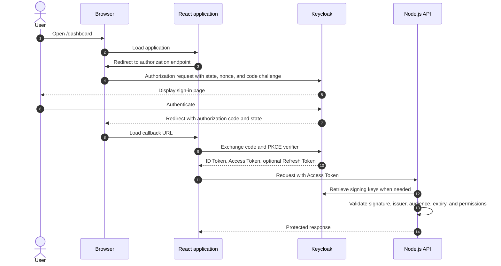
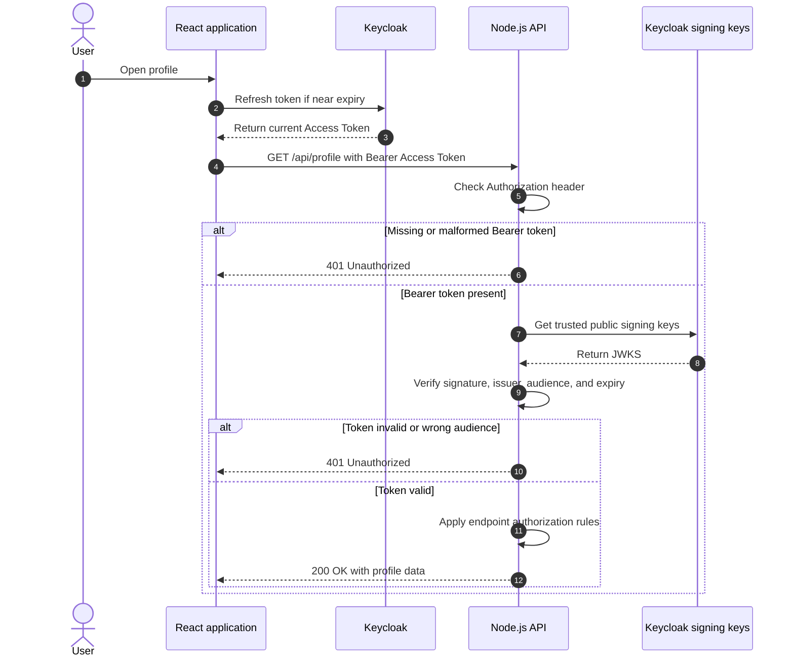
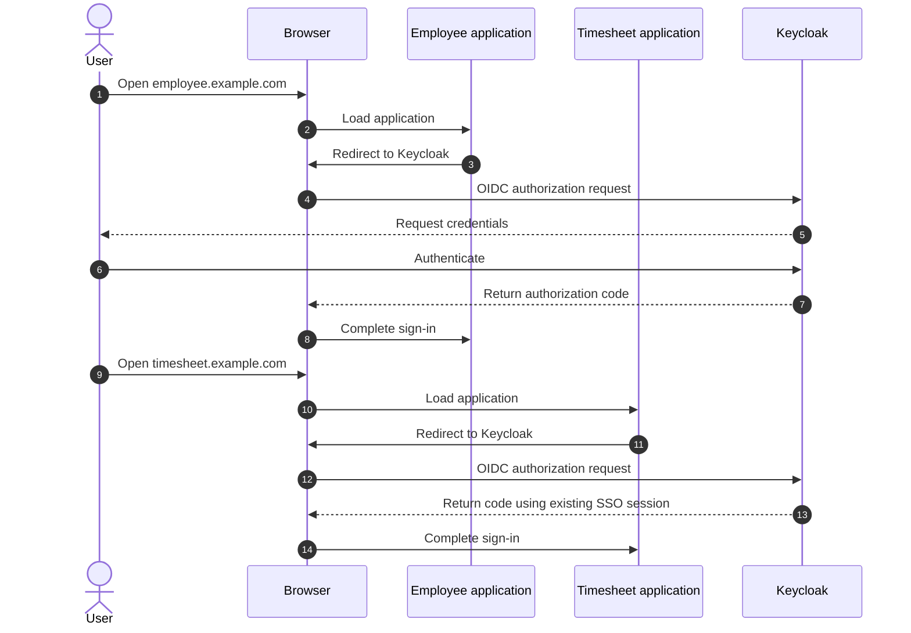

# Understanding OpenID Connect (OIDC) with Keycloak: From Authentication Theory to Implementation

**Technical article** · Authentication and security · Intermediate · 12–15 min read

Authentication is one of the most important parts of modern web applications, but implementing it correctly is surprisingly difficult.

A typical application needs to handle user credentials, login sessions, token expiration, password resets, multi-factor authentication, and sometimes Single Sign-On (SSO) across multiple services.

Instead of implementing all these features independently, we can delegate authentication to a dedicated Identity Provider (IdP).

This is where OpenID Connect (OIDC) and Keycloak come into play.

In this article, we'll explore how OIDC works internally, how Keycloak implements it, and how to integrate it into a React frontend with a protected Node.js API.

## 1. Understanding the authentication problem

Imagine we're building a system with three applications:

- An employee management application
- A timesheet management application
- An analytics dashboard

Each application has its own frontend and backend.

Without centralized authentication, users might need to log in separately to every application. Each backend must also maintain its own authentication mechanisms.

**Without centralized authentication**

This creates several problems: duplicated account management, inconsistent security policies, complicated user provisioning, and higher maintenance costs.

Now imagine replacing the three authentication systems with one centralized identity service.

**Centralized authentication with Keycloak**

All three applications can now trust Keycloak to authenticate their users.

This is the fundamental motivation behind centralized identity management.

## 2. What is OpenID Connect?

OpenID Connect (OIDC) is an identity layer built on top of OAuth 2.0.

Its primary purpose is to allow an application to verify a user's identity through a trusted authentication provider.

To understand OIDC, we first need to distinguish authentication from authorization.

| Concept                | Question             | Example                                            |
| ---------------------- | -------------------- | -------------------------------------------------- |
| Authentication (AuthN) | Who are you?         | Verifying that a user is Alice                     |
| Authorization (AuthZ)  | What can you access? | Alice may view reports but cannot delete employees |

OAuth 2.0 is primarily a framework for delegated authorization. It lets applications obtain access tokens for protected resources.

OIDC adds a standardized authentication layer, including an ID Token, allowing applications to verify who authenticated.

### OAuth 2.0 vs OIDC

| Protocol | Purpose | Token | Use |
| --- | --- | --- | --- |
| OAuth 2.0 | Delegated authorization | Access Token | Access protected resources |
| OpenID Connect | Authentication | ID Token | Describe the authenticated user |
| OpenID Connect | API authorization | Access Token | Access protected APIs |

For example, suppose a user logs in using Keycloak.

Keycloak can issue both an ID Token containing authentication information and an Access Token for calling a backend service.

These tokens serve different purposes and should not be used interchangeably.

## 3. What is Keycloak?

Keycloak is an open-source Identity and Access Management (IAM) platform.

It implements standards including OpenID Connect, OAuth 2.0, and SAML, providing a ready-made solution for authentication and identity-related workflows.

Keycloak supports capabilities such as SSO, user management, role mapping, external identity providers, authentication flows, and multi-factor authentication.

### Core Keycloak concepts

| Component         | Responsibility                                            |
| ----------------- | --------------------------------------------------------- |
| Realm             | An isolated identity space with its own users and clients |
| Client            | An application or service registered with Keycloak        |
| User              | An identity authenticated through Keycloak                |
| Role              | A named permission or group of permissions                |
| Group             | A collection of users, often with shared roles            |
| Identity Provider | An external authentication provider, such as Google       |
| Client Scope      | Controls protocol scopes and claims exposed to clients    |

A useful way to think about Keycloak is that a realm is an isolated authentication domain.

A realm can contain multiple clients, users, groups, and roles.

Applications registered inside the same realm can participate in SSO through the browser's Keycloak session.

However, being authenticated does not automatically mean that a user is authorized to access every application or API. Each application still needs to enforce its authorization rules.

## 4. Understanding the OIDC Authorization Code Flow

The most important OIDC flow for modern interactive web applications is the Authorization Code Flow with PKCE.

PKCE stands for Proof Key for Code Exchange.

This mechanism protects the authorization code exchange by binding it to the client that initiated the login attempt.

Let's examine the complete flow.

### Authorization Code Flow with PKCE



### Step 1 — User opens the application

A user visits:

```
https://app.example.com/dashboard
```

The application checks whether the user is authenticated.

If no valid authentication state exists, the application initiates a login redirect.

### Step 2 — Redirect to Keycloak

The application sends the browser to Keycloak's authorization endpoint with parameters similar to:

```
GET /realms/company/protocol/openid-connect/auth
  ?client_id=employee-web
  &response_type=code
  &scope=openid profile email
  &redirect_uri=https://app.example.com/callback
  &state=<random-state>
  &nonce=<random-nonce>
  &code_challenge=<pkce-challenge>
  &code_challenge_method=S256
```

The `state` parameter protects the login flow against request forgery and response mix-ups. The `nonce` is used to bind the resulting ID Token to the authentication request.

The `code_challenge` is derived from a randomly generated `code_verifier` using SHA-256.

### Step 3 — User authenticates

Keycloak displays its login interface.

The user enters their credentials or authenticates using an external identity provider.

The application does not need to receive or handle the user's password.

### Step 4 — Keycloak returns an authorization code

After authentication succeeds, Keycloak redirects the browser back to the registered callback URL.

```
https://app.example.com/callback
  ?code=abc123
  &state=<original-state>
```

The returned code is short-lived and single-use.

It is not yet an Access Token.

### Step 5 — Exchange the code for tokens

The OIDC client submits the authorization code together with its original PKCE verifier.

```
POST /realms/company/protocol/openid-connect/token
Content-Type: application/x-www-form-urlencoded

grant_type=authorization_code
&client_id=employee-web
&code=abc123
&redirect_uri=https://app.example.com/callback
&code_verifier=<original-verifier>
```

Keycloak validates the code, registered client, redirect URI, and PKCE verifier.

For a confidential server-side client, client authentication is also required.

### Step 6 — Receive tokens

An illustrative response looks like this:

```
{
  "access_token": "eyJhbGciOiJSUzI1NiIs...",
  "id_token": "eyJhbGciOiJSUzI1NiIs...",
  "refresh_token": "eyJhbGciOiJSUzI1NiIs...",
  "token_type": "Bearer",
  "expires_in": 300
}
```

The client can now establish an authenticated application state and use the Access Token for appropriately authorized API requests.

## 5. Understanding the three tokens

OIDC commonly involves three different tokens.

ID Token

Contains standardized authentication claims such as the subject (`sub`), issuer (`iss`), audience (`aud`), and authentication timestamps. It is intended for the OIDC client.

Access Token

Represents authorization to access protected resources. It is sent to resource servers such as a backend API.

Refresh Token

Allows a client to obtain a new Access Token without prompting the user to authenticate again, subject to session lifetime and refresh-token policies.

### What does an ID Token contain?

A decoded ID Token payload might look like:

```
{
  "iss": "https://auth.example.com/realms/company",
  "sub": "f3c6e2d8-1234-5678-9012-abcdef123456",
  "aud": "employee-web",
  "exp": 1793451600,
  "iat": 1793451300,
  "auth_time": 1793451250,
  "nonce": "random-nonce",
  "preferred_username": "alice",
  "email": "alice@example.com"
}
```

The application validates the token's signature, issuer, audience, expiry, and applicable nonce before trusting its authentication claims.

Not every deployment includes the same optional claims; scopes and protocol mappers determine what is available.

### Why doesn't the backend simply use the ID Token?

Because the ID Token is meant to communicate the authentication result to the OIDC client, not authorize requests to an arbitrary API.

The backend should receive an Access Token intended for it and validate that token according to its issuer, signature, audience, expiry, and authorization requirements.

## 6. Setting up Keycloak locally

Let's create a local development environment.

We'll use Docker and run Keycloak on port `8080`.

```bash
docker run -d \
  --name keycloak \
  -p 8080:8080 \
  -e KC_BOOTSTRAP_ADMIN_USERNAME=admin \
  -e KC_BOOTSTRAP_ADMIN_PASSWORD=admin \
  quay.io/keycloak/keycloak:26.8.0 \
  start-dev

```

This example uses a Keycloak 26.8 release and the development server mode. The release line includes Keycloak 26.8.0, published in October 2026.


In a real deployment, pin the image to a reviewed release, configure a persistent database, enable TLS, and use production server settings rather than `start-dev`.

Open the administration console:

`http://localhost:8080/admin`

Log in with the bootstrap admin credentials.

### Configure the realm

Create a realm named:

```
company
```

Then create an OIDC client:

| Setting               | Value                     |
| --------------------- | ------------------------- |
| Client ID             | `employee-web`            |
| Client type           | OpenID Connect            |
| Client authentication | Off                       |
| Standard flow         | Enabled                   |
| Implicit flow         | Disabled                  |
| Direct access grants  | Disabled                  |
| PKCE method           | S256                      |
| Valid redirect URIs   | `http://localhost:5173/*` |
| Web origins           | `http://localhost:5173`   |

This client is public because a browser application cannot securely store a client secret.

For production, restrict redirect URIs to the exact application callback routes wherever possible. Do not use unrestricted redirect patterns.

Create a test user and assign a password through Keycloak's user management interface.

## 7. Implementing OIDC in React

We'll implement a simple React application using Keycloak's official JavaScript adapter.

Install the dependency:

```
npm install keycloak-js
```

The official adapter handles the authorization redirect, PKCE exchange, token refresh, and authentication state.


Keycloak


### Create the Keycloak configuration

`src/auth/keycloak.ts`

```

import Keycloak from "keycloak-js";

export const keycloak = new Keycloak({
  url: "http://localhost:8080",
  realm: "company",
  clientId: "employee-web",
});

```

### Initialize authentication

`src/main.tsx`

```

import React from "react";
import ReactDOM from "react-dom/client";
import { keycloak } from "./auth/keycloak";
import App from "./App";

async function bootstrap() {
  try {
    await keycloak.init({
      onLoad: "login-required",
      pkceMethod: "S256",
      checkLoginIframe: false,
    });

    ReactDOM.createRoot(
      document.getElementById("root")!
    ).render(
      <React.StrictMode>
        <App />
      </React.StrictMode>
    );
  } catch (error) {
    console.error("Authentication failed:", error);
  }
}

void bootstrap();

```

With `login-required`, the adapter initiates authentication when the user is not logged in.

After successful authentication, the application renders normally.

For a public landing page with optional authentication, `check-sso` may be a better choice, although silent SSO checks can be limited by browser tracking protection.

### Display the authenticated user

`src/App.tsx`

```

import { keycloak } from "./auth/keycloak";

export default function App() {
  const username =
    keycloak.tokenParsed?.preferred_username;

  async function logout() {
    await keycloak.logout({
      redirectUri: window.location.origin,
    });
  }

  return (
    <main>
      <h1>Welcome, {username}</h1>
      <p>You are authenticated through Keycloak.</p>

      <button onClick={logout}>
        Logout
      </button>
    </main>
  );
}

```

At this point, our React application delegates authentication to Keycloak.

But displaying a logged-in user is only half the implementation.

The next challenge is securing the backend.

## 8. Protecting a Node.js API


The React application calls `GET http://localhost:3001/api/profile` with a Keycloak Access Token. Before sending the request, it refreshes the token if it is close to expiring.



The API must validate every Access Token independently. A valid signature alone is not enough: check the expected issuer, the API audience (`backend-api`), expiry, and required permissions. Return `401 Unauthorized` when authentication fails and enforce application authorization before returning protected data.

Configure Keycloak to include `backend-api` in the Access Token's `aud` claim, for example with an Audience mapper in an assigned client scope. Creating a client named `backend-api` does not add that audience automatically. A Node.js implementation can use `jose` to verify tokens against Keycloak's published JWKS.

## 9. How Keycloak enables Single Sign-On

Now assume we have two React applications:

```
employee.example.com
timesheet.example.com
```

Both use the same Keycloak realm.

A user logs into the Employee application and establishes an authenticated session with Keycloak.

Later, the user opens the Timesheet application.

The Timesheet application redirects to Keycloak as part of its own OIDC authentication flow.

Because the browser already has a valid Keycloak session, Keycloak can issue a new authorization code without asking the user to enter their credentials again.

### Single Sign-On across applications



The critical point is that SSO does not mean the two applications share identical tokens or local application sessions.

Instead, they share trust in a central identity provider and benefit from its existing browser authentication session.

## 10. Refresh Tokens and session management

Access Tokens usually have relatively short lifetimes.

Suppose an Access Token expires after five minutes. Without a refresh mechanism, users would need to reauthenticate frequently.

OIDC clients can use Refresh Tokens to request new Access Tokens.

Keycloak provides a refresh endpoint through the same token endpoint, using the `refresh_token` grant type.

When using `keycloak-js`, the adapter handles this process through `updateToken()`.

```
try {
  await keycloak.updateToken(30);

  // Continue with authenticated API request.
} catch {
  // Refresh failed; prompt reauthentication.
  await keycloak.login();
}
```

Keycloak also supports configurable SSO session lifetimes and refresh-token rotation.


For a browser-based application, avoid persisting raw tokens in `localStorage`. Keycloak's JavaScript adapter intentionally keeps its tokens in memory.

For systems with stricter security requirements, consider a Backend-for-Frontend (BFF) architecture, where a trusted server manages OAuth tokens and the browser holds a secure, HttpOnly session cookie.

## 11. Authentication vs authorization in Keycloak

A successfully authenticated user should not automatically have access to every resource.

For example, an employee might be allowed to read their own timesheets but should not be able to approve payroll.

Keycloak supports roles at multiple levels.

| Role type              | Scope                   | Example                     |
| ---------------------- | ----------------------- | --------------------------- |
| Realm role             | Realm-wide              | `employee`, `system-admin`  |
| Client role            | Specific client         | `timesheet:approve`         |
| Application permission | Enforced by application | Approve only direct reports |

Keycloak can place role mappings into tokens through protocol mappers.

For example, an Access Token may include:

```
{
  "realm_access": {
    "roles": ["employee"]
  },
  "resource_access": {
    "timesheet-api": {
      "roles": ["read", "approve"]
    }
  }
}
```

However, the presence of a role alone is not enough to implement complex business authorization.

Imagine a manager who may approve timesheets, but only for employees in their own team.

Keycloak can tell the backend that the user has the `approve` role. The backend must still verify whether the timesheet belongs to the manager's team.

This separation is essential:

Keycloak manages identity and centrally configured access claims. The application enforces domain-specific business rules.

## 12. Security practices for production systems

When integrating OIDC, it is easy to build something that works but is not properly secured.

The following checklist covers common implementation mistakes.

**OIDC production checklist**

- [ ] Use Authorization Code Flow with PKCE (S256) for browser-based clients.
- [ ] Use HTTPS for all production authentication and API endpoints.
- [ ] Register exact redirect URIs and restrict Web Origins.
- [ ] Never expose a confidential client secret in browser code.
- [ ] Validate JWT signatures, issuer, audience, and expiry on the backend.
- [ ] Use ID Tokens for authentication and suitable Access Tokens for APIs.
- [ ] Validate state and nonce as appropriate for the OIDC flow.
- [ ] Keep browser tokens in memory and avoid persistent JavaScript-accessible storage.
- [ ] Enforce authorization rules independently on every protected API.
- [ ] Configure session expiration, logout, MFA, and appropriate refresh-token policies.

A few especially important pitfalls deserve attention.

First, a browser cannot securely hold a client secret. Browser-only applications must be treated as public clients.

Second, verifying a JWT's signature is not sufficient if the API does not also validate the token's intended audience.

Third, logging out of a local application and terminating the Keycloak SSO session are different operations. Logout behavior should be designed across the entire application ecosystem.

Finally, a centralized identity provider is a critical infrastructure dependency. Production Keycloak deployments need proper monitoring, backup strategies, high availability where necessary, and secure key management.

## 13. When should you use Keycloak?

Keycloak is a particularly strong fit when multiple applications need to share user identities and authentication policies.

For example, an organization with a React frontend, a Java Spring Boot backend, a NestJS API, and several internal tools can centralize authentication in Keycloak while keeping business authorization inside the individual services.

It is also useful when the organization needs self-hosted identity management, SSO, external identity provider federation, or flexible role and user management.

However, Keycloak introduces operational responsibility. For a small application with minimal authentication requirements, a managed identity platform or framework-native authentication solution may be simpler.

The correct decision depends on the number of applications, security requirements, infrastructure capabilities, and long-term ownership costs.

## 14. Final architecture

Let's put all the pieces together.

In this architecture:

- The React application uses OIDC to initiate login and obtain authentication tokens.
- Keycloak authenticates users, manages SSO sessions, and issues tokens according to realm and client configuration.
- The backend independently validates Access Tokens and enforces authorization rules.
- The application database stores business data, while Keycloak maintains identity-related information.

This separation reduces duplicated authentication logic and establishes clearer security boundaries between components.

## Conclusion

OpenID Connect is much more than a login redirect. It defines a standardized way for applications to establish user identity through a trusted provider.

Keycloak implements the identity infrastructure required to support OIDC, centralized authentication, SSO, and many associated identity management capabilities.

The most important ideas to remember are:

1. OIDC builds an authentication layer on OAuth 2.0.
2. Keycloak acts as the Identity Provider, not as a replacement for application-level authorization.
3. Authorization Code Flow with PKCE is the preferred approach for modern browser-based authentication.
4. ID Tokens and Access Tokens have different audiences and responsibilities.
5. Backend APIs must validate tokens and enforce permissions independently.

With these concepts in place, developers can build multi-application authentication systems without reimplementing identity management from scratch.

## References and further reading

- [OpenID Connect Core Specification](https://openid.net/specs/openid-connect-core-1_0.html?utm_source=chatgpt.com)
- [Keycloak Server Administration Guide](https://www.keycloak.org/docs/latest/server_admin/?utm_source=chatgpt.com)
- [Securing Applications with OpenID Connect](https://www.keycloak.org/securing-apps/oidc-layers?utm_source=chatgpt.com)
- [Keycloak JavaScript Adapter Documentation](https://www.keycloak.org/securing-apps/javascript-adapter?utm_source=chatgpt.com)

Suggested tags: Authentication · OpenID Connect · OAuth 2.0 · Keycloak · React · Node.js · Security · SSO